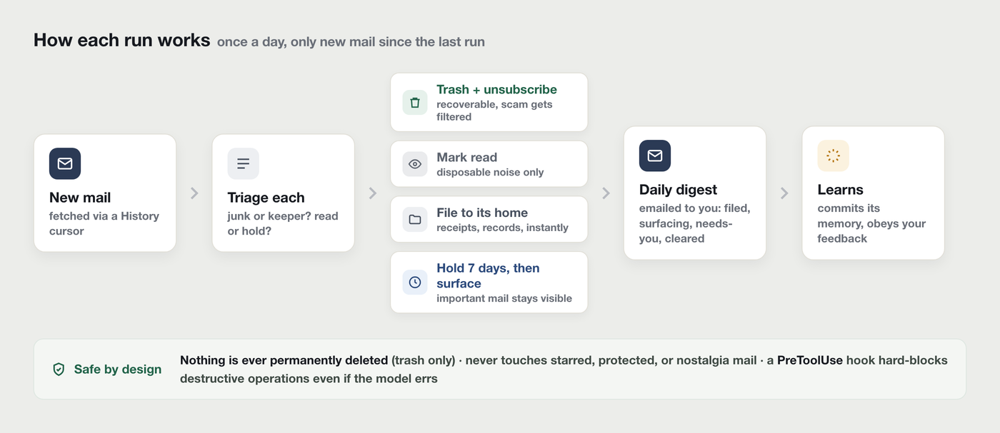
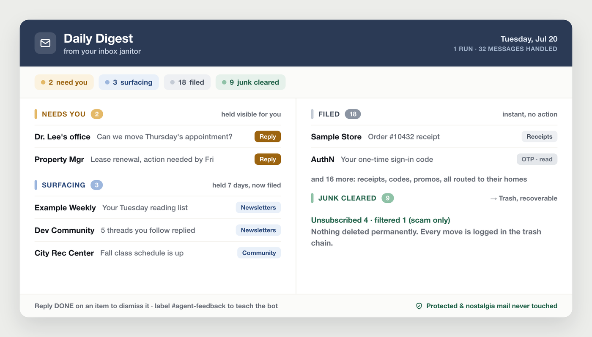

# janitor-template

A daily email-cleanup bot for Gmail, run by Claude.



- Triages new mail once a day
- Trashes junk and unsubscribes you
- Files records to your labels
- Keeps important mail in view for 7 days
- Emails you a daily digest
- Learns from your feedback
- Trash only, never a permanent delete
- Leaves starred, protected and "nostalgia" mail alone



*An illustrative digest, with placeholder data.*

## Talk to it

- Put the `#agent-feedback` label on an email you've replied to with an instruction.
- Put `#agent-undo` on an email to reverse its last action.
- Reply `DONE` to a digest item to dismiss it.

## Set it up

1. Create a Google Cloud OAuth client with the Gmail API on and the scopes `gmail.modify` and `gmail.settings.basic`. Get a refresh token, and never commit it.
2. Replace the placeholders. Find them with:

   ```bash
   grep -rIn "{{" --exclude-dir=.git .
   ```

3. Edit `memory/rules.md`: your labels, protected senders and nostalgia keeps.
4. In Gmail, create your labels plus `#agent-feedback`, `#agent-undo`, `Digest`, `zz-Surfacing` and `zz-Pinned`.
5. Test it locally, then follow [PROMPT.md](PROMPT.md):

   ```bash
   export OWNER_EMAIL=you@example.com
   export GMAIL_CLIENT_ID=... GMAIL_CLIENT_SECRET=... GMAIL_REFRESH_TOKEN=...
   source scripts/lib.sh
   get_access_token
   ```

6. Put your copy in a private repo and run it daily (a Claude routine, or cron). Watch the first run.

## More

- [PACKAGE.md](PACKAGE.md): every file, and the command-center skill
- [PROMPT.md](PROMPT.md): what each run does
- [CLAUDE.md](CLAUDE.md): the rules it never breaks

## License

MIT. See [LICENSE](LICENSE).
